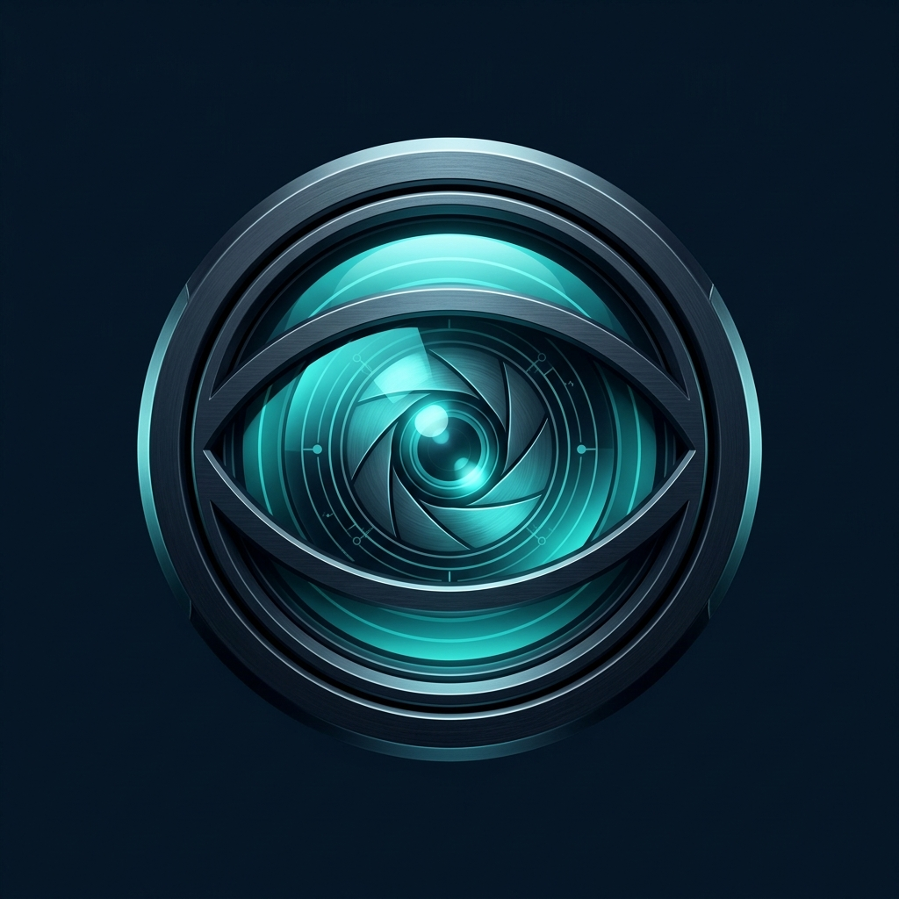
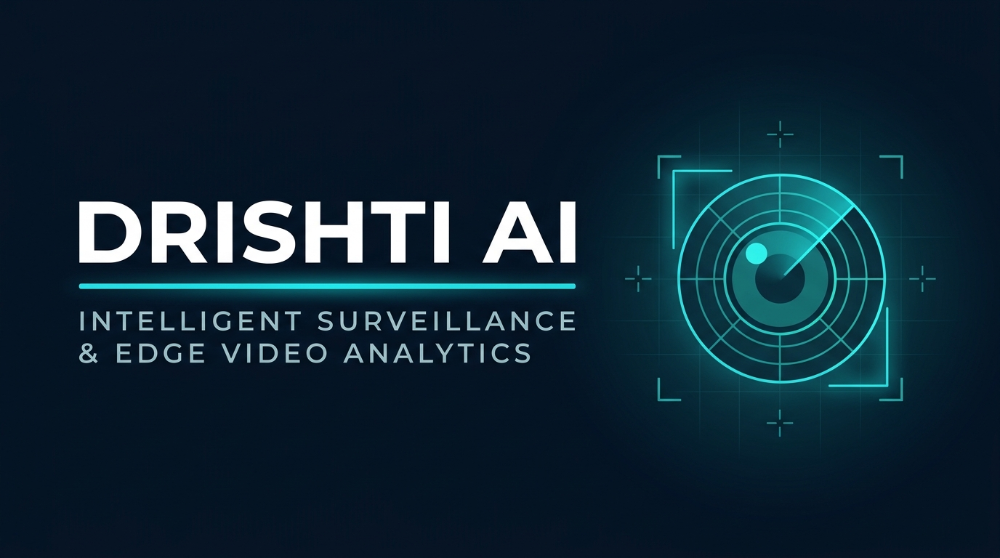
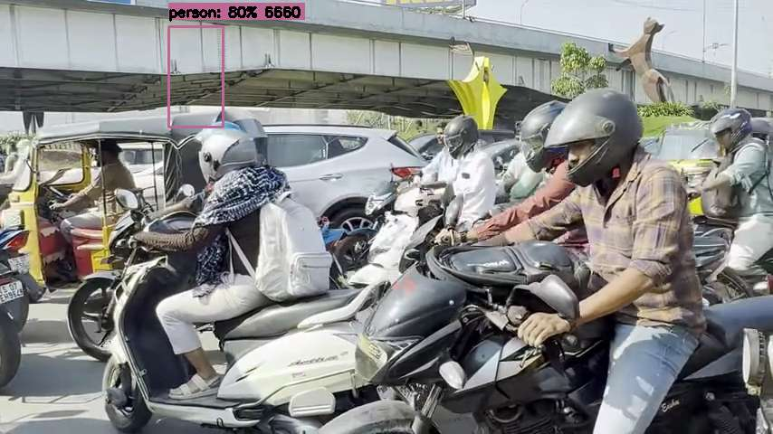
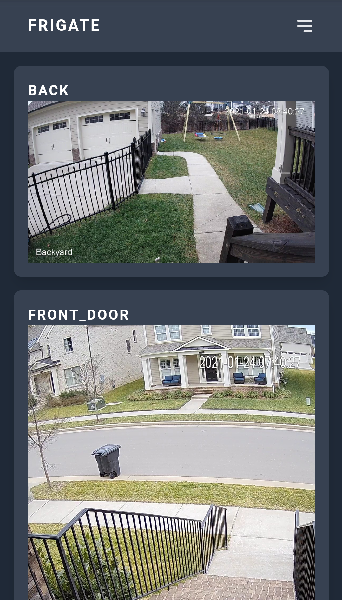
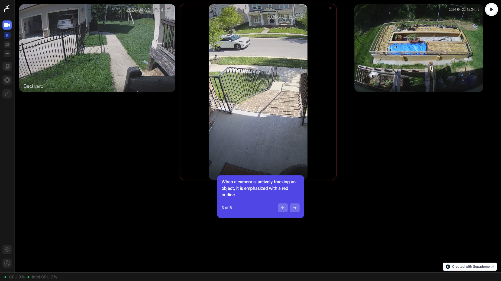
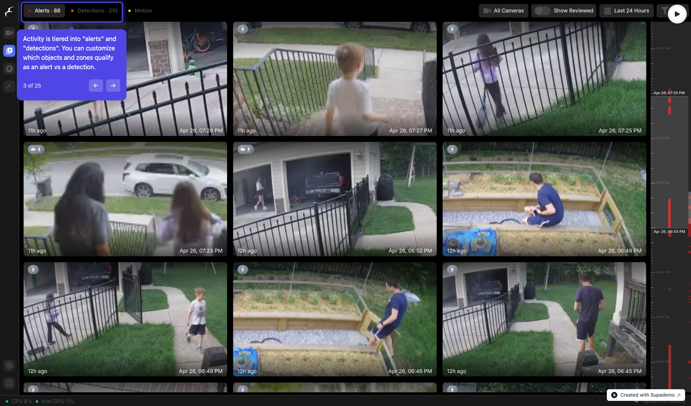
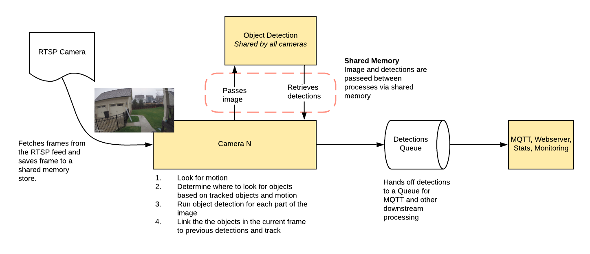
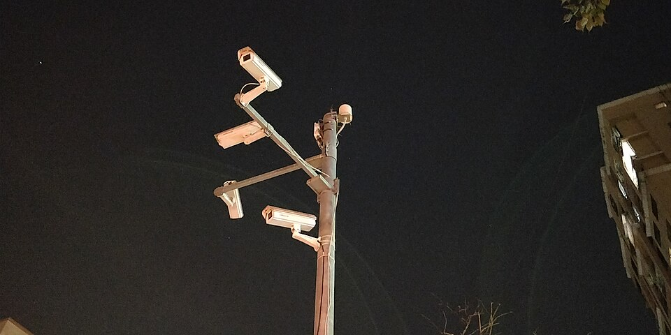

<div align="center">



<h1>DRISHTI AI V2</h1>

<p><b>Real-Time Public Safety, Indian Traffic Intelligence, Pose &amp; Fall Detection, and Emergency SOS Platform</b></p>



<br><br>

[](LICENSE)
[](LICENSE)
[](ARM64_SETUP.md)
[](MODEL_CARD.md)
[](compose.drishti.yml)

**Local, privacy-first video intelligence built on Frigate NVR for Snapdragon X ARM64 &amp; Linux.**  
Combines live laptop webcam (`CAM-001`) human pose &amp; fall monitoring, safe Test-Mode SOS workflows, multi-camera traffic &amp; collision-risk analytics, and unified video upload intelligence — running 100% locally on CPU.

</div>

---

## Demo Videos

Watch the raw Hyderabad traffic input alongside the CPU-annotated YOLOX + tracking output:

| Input Clip (`demo/hyderabad.mp4`) | Annotated AI Output (`validation/sample-result/review.mp4`) |
| --- | --- |
| <video src="demo/hyderabad.mp4" controls muted width="420"></video> | <video src="validation/sample-result/review.mp4" controls muted width="420"></video> |
| [Open `demo/hyderabad.mp4`](demo/hyderabad.mp4) (20s Hyderabad road scene, 854x480, 15 FPS) | [Open `validation/sample-result/review.mp4`](validation/sample-result/review.mp4) (Annotated detections &amp; trajectories) |

---

## Visual Showcase

<table>
  <tr>
    <td align="center" width="50%">
      <br>
      <sub><b>Live NVR Event Snapshot</b> — Automatic detection from <code>hyderabad_replay</code></sub>
    </td>
    <td align="center" width="50%">
      <br>
      <sub><b>Dashboard Overview</b> — Camera grid and live status</sub>
    </td>
  </tr>
  <tr>
    <td align="center" width="50%">
      <br>
      <sub><b>Live Camera View</b> — Real-time stream monitoring</sub>
    </td>
    <td align="center" width="50%">
      <br>
      <sub><b>Review &amp; Explore</b> — Tracked objects, snapshots, and recording history</sub>
    </td>
  </tr>
</table>

<p align="center">
  
  <br>
  <sub><b>Pipeline Architecture</b> — Motion gating, regional detection, tracking, pose/fall &amp; incident fusion</sub>
</p>

---

## Key Capabilities in V2

| Module | What It Does | Page / Route | Documentation |
| --- | --- | --- | --- |
| **Human Safety Live Webcam (`CAM-001`)** | Live laptop webcam capture, YOLOX person detection, MoveNet 17-keypoint pose skeleton, posture &amp; temporal fall detection | `/human-safety` | [HUMAN_SAFETY.md](HUMAN_SAFETY.md) · [WEBCAM_SETUP.md](WEBCAM_SETUP.md) |
| **Emergency Command Center &amp; SOS** | SQLite-persisted multi-camera incident feed, local audible alarm, `15s` SOS countdown, `I Am Okay` / `Cancel` / `Confirm`, mandatory **TEST MODE** | `/command-center` | [SOS_SYSTEM.md](SOS_SYSTEM.md) |
| **Traffic &amp; Accident Intelligence** | Temporal collision detection (0 false alarms on normal Hyderabad traffic), homography-aware collision risk (TTC/PET), camera calibration | `/intelligence` | [ACCIDENT_DETECTION.md](ACCIDENT_DETECTION.md) |
| **Model Registry &amp; Diagnostics** | Verified SHA-256 registry (`yolox-nano-416`, `yolox-s-640`, `movenet-lightning-192`, `YOLOv8/11/26` decoders), ARM64 CPU/RAM telemetry | `/models` · `/diagnostics` | [MODEL_CARD.md](MODEL_CARD.md) · [BENCHMARK_REPORT.md](BENCHMARK_REPORT.md) |
| **Unified Video Upload Analysis** | Selectable model &amp; FPS (1–15 FPS), unique tracked counts, pose &amp; fall overlays, `review.mp4` + `report.json` + `report.csv` | `/video-analysis` | [VIDEO_ANALYSIS.md](VIDEO_ANALYSIS.md) |

---

## Quick Start (Snapdragon X ARM64 / Docker)

```powershell
cd DRISHTI-AI
docker compose -f compose.drishti.yml up --build -d
docker compose -f compose.drishti.yml ps
docker compose -f compose.drishti.yml logs nvr
```

1. Open **<http://127.0.0.1:8971>** and sign in as `admin` using the first-start password printed in `docker compose -f compose.drishti.yml logs nvr`.
2. Open **Human Safety Webcam** (`/human-safety`) and click **Start Camera** to test `CAM-001` with live pose &amp; fall detection.
3. Open **Emergency Command Center** (`/command-center`) to view persisted incidents, test local SOS, and monitor multi-camera health.
4. Optional native Windows webcam bridge: run `.\scripts\start_webcam_bridge.bat` (`http://127.0.0.1:8765`).

---

## Measured ARM64 CPU Benchmarks (`aarch64`, ONNX Runtime `1.32.0`)

| Model ID | Input | COCO-20 Precision | COCO-20 Recall | Median Latency | Hyderabad 5 FPS (`100 frames`) | False Accidents |
| --- | ---: | ---: | ---: | ---: | ---: | ---: |
| `yolox-nano-416` | 416x416 | 86.21% | 49.34% | 98.89 ms | 3.03 FPS (`47` unique tracks) | **0** |
| `yolox-s-640` | 640x640 | 92.62% | 74.34% | 1660.07 ms | 0.40 FPS (`75` unique tracks) | **0** |

Full reports: [AUDIT_REPORT.md](AUDIT_REPORT.md) · [BENCHMARK_REPORT.md](BENCHMARK_REPORT.md) · [VALIDATION_REPORT.md](VALIDATION_REPORT.md) · [ARM64_SETUP.md](ARM64_SETUP.md) · [KNOWN_LIMITATIONS.md](KNOWN_LIMITATIONS.md)

### Crash1 Regressions

Native ARM64 measurements use the supplied `validation/crash1.mp4` reproduction clip:

| Model | Input | Median inference | End-to-end FPS | Incident result |
| --- | ---: | ---: | ---: | --- |
| `yolox-nano-416` | 416x416 | 18.98 ms | 4.91 | 0 retained incidents after moving-camera false-positive suppression |
| `yolox-tiny-416` | 416x416 | 62.28 ms | 3.17 | Prior-result baseline retained in audit artifacts, not a production accuracy claim |
| `yolox-s-640` | 640x640 | 233.14 ms | 2.04 | Prior-result baseline retained in audit artifacts, not a production accuracy claim |

These measurements verify runtime behavior only. They do not prove real-world accident recall or precision.

<p align="center">
  
  <br>
  <sub>Photograph of the installation in Matunga by Punit Rajpal, CC0. Demonstration traffic footage from Hyderabad. <a href="ATTRIBUTION.md">Media and software credits</a></sub>
</p>

---

## License &amp; Author

- **Maintainer &amp; Copyright Holder:** **PALLEM DINESH KUMAR REDDY**
- **License:** MIT License — see [LICENSE](LICENSE).
- **Upstream &amp; Media Credits:** Frigate, Inc. and contributors retain upstream credit. See [ATTRIBUTION.md](ATTRIBUTION.md) and [TRADEMARK.md](TRADEMARK.md).
